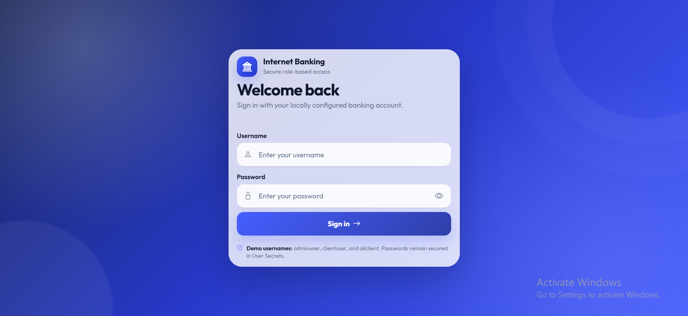
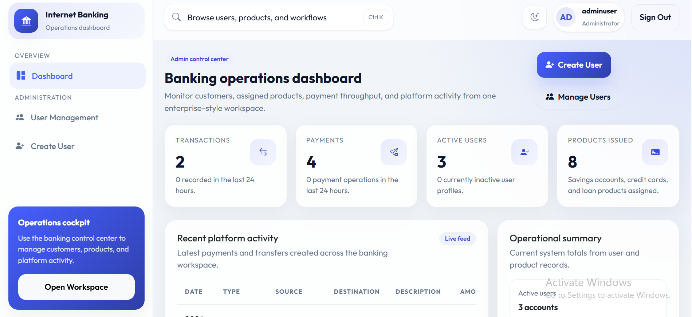
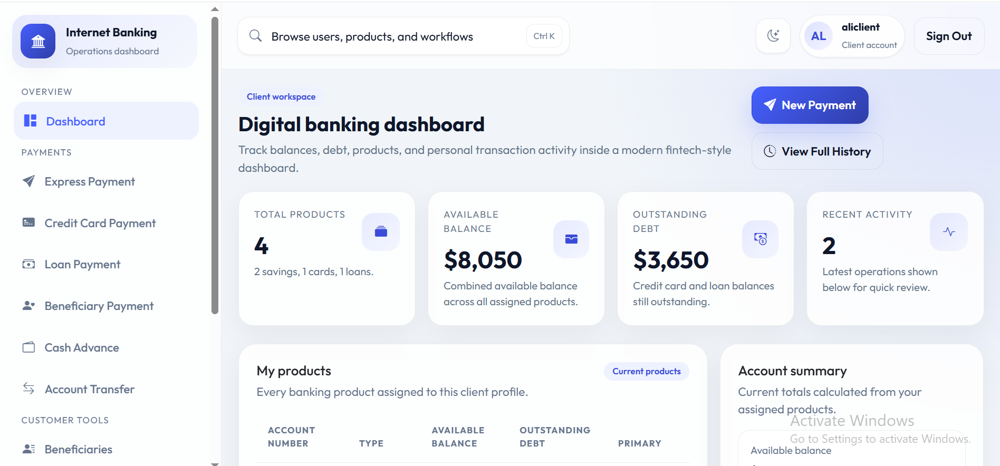

<h1 align="center">🏦 Internet Banking</h1>

<p align="center">
  <b>A secure, responsive, portfolio-ready Internet Banking demonstration built with ASP.NET Core MVC, Razor Views, ASP.NET Core Identity, Entity Framework Core, SQL Server, Bootstrap 5, and xUnit.</b>
</p>

<p align="center">
  
  
  
  
  
  
  
  
</p>

---

## 📸 Project Screenshots

| Responsive Sign In |
|---|
|  |


| Administrator Dashboard | Client Dashboard |
|---|---|
|  |  |

---

## 🚀 Project Overview

**Internet Banking** is a full-stack ASP.NET Core MVC application that demonstrates secure role-based banking workflows in a layered .NET solution.

Administrators can manage users and banking products. Clients can view balances, manage beneficiaries, make payments, transfer funds between owned accounts, pay loans and credit cards, request cash advances, and review transaction history.

The frontend is built with **server-rendered Razor Views**, Bootstrap 5.3.3, custom CSS, and JavaScript. It does **not** use React or Angular. The responsive sign-in page is designed to fit standard mobile, tablet, laptop, and desktop viewports without page-level vertical scrolling.


---

## 🎯 Project Purpose

This project demonstrates practical junior-to-intermediate ASP.NET Core engineering with:

- Layered application architecture
- ASP.NET Core MVC and Razor Views
- ASP.NET Core Identity and secure cookie authentication
- Admin and Client role authorization
- Server-side ownership validation
- SQL Server and Entity Framework Core migrations
- Transactional monetary operations
- Decimal monetary precision
- Optimistic concurrency through SQL Server row versions
- One-time payment submission tokens
- Responsive Bootstrap-based user interfaces
- Development-only demo seeding through User Secrets
- Automated unit and security regression tests
- Secret-safe repository configuration

---

## ⭐ Key Highlights

- 🔐 ASP.NET Core Identity with secure authentication cookies
- 👥 Separate `Admin` and `Client` application roles
- 🛡️ Role-protected controllers and server-side account ownership checks
- 🚫 Deactivated accounts are rejected globally during cookie validation
- 🔄 Identity security-stamp rotation invalidates active sessions
- 🔒 Five failed login attempts trigger a five-minute account lockout
- 🍪 HTTP-only, secure, SameSite cookies
- 🧾 POST-backed sign-out with anti-forgery validation
- 💳 Savings account, credit card, and loan products
- 💸 Express payments and beneficiary payments
- 🔁 Transfers between owned savings accounts
- 🏧 Credit-card cash advances with fee calculation
- 📊 Administrator and client dashboards
- 🧮 `decimal(18,2)` monetary storage and calculations
- 🧱 Serializable database transactions for financial operations
- ⚡ SQL Server row-version concurrency protection
- 🔢 Cryptographically generated, unique nine-character account numbers
- 🛑 Duplicate payment submission protection
- 📱 Compact responsive sign-in interface
- 🧪 27 passing xUnit tests
- 🔑 Local credentials stored with .NET User Secrets, not committed to Git

---

## ✨ Features

### 👨‍💼 Administrator Features

| Feature | Description |
|---|---|
| Dashboard | Reviews user, product, payment, and transaction statistics |
| User Listing | Views registered users and account status |
| Create Client | Creates client accounts through a protected administrator workflow |
| Edit Client | Updates client details with validation |
| Activate User | Restores access for an inactive client |
| Deactivate User | Disables access and rotates the Identity security stamp |
| Product Management | Lists products assigned to a selected client |
| Savings Account | Creates savings products and designates a principal account |
| Credit Card | Creates credit-card products with available balance and debt tracking |
| Loan | Creates loan products and deposits approved funds into a savings account |
| Product Deletion | Removes eligible products through protected POST operations |
| Recent Activity | Reviews recent payment and transaction activity |

### 👤 Client Features

| Feature | Description |
|---|---|
| Client Dashboard | Displays owned products, balances, liabilities, and activity |
| Express Payment | Sends money from an owned account to a valid destination account |
| Beneficiaries | Adds, lists, and deletes owned beneficiaries |
| Beneficiary Payment | Pays a destination that remains in the authenticated user's beneficiary list |
| Credit Card Payment | Pays an owned credit-card debt from an owned savings account |
| Loan Payment | Pays an owned loan from an owned savings account |
| Account Transfer | Transfers funds between the client's owned savings accounts |
| Cash Advance | Moves funds from an owned credit card to an owned savings account |
| Payment Confirmation | Reviews the operation before final submission |
| History | Displays payment and transfer records |

### 📱 Responsive User Interface

- Razor Views rendered by ASP.NET Core MVC
- Bootstrap 5.3.3 responsive grid and components
- Custom banking dashboard styling
- Compact viewport-aware sign-in form
- Mobile navigation and responsive sidebar behavior
- Responsive cards, forms, tables, and action controls
- Horizontal table scrolling where tabular data cannot safely collapse
- Support for common phone, tablet, laptop, and desktop widths

---

## 🛠 Technology Stack

| Layer | Technologies |
|---|---|
| Runtime | .NET 8 |
| Language | C# |
| Web Framework | ASP.NET Core 8 MVC |
| Frontend | Razor Views, HTML5, CSS3, JavaScript |
| UI Framework | Bootstrap 5.3.3 |
| Authentication | ASP.NET Core Identity |
| Authorization | Role-based authorization and ownership validation |
| Session | Temporary one-time payment submission tokens only |
| ORM | Entity Framework Core 8.0.29 |
| Database | Microsoft SQL Server / SQL Server LocalDB |
| Mapping | AutoMapper 13.0.1 |
| Serialization | Newtonsoft.Json 13.0.3 |
| Testing | xUnit 2.9.2 |
| Test Runner | Microsoft.NET.Test.Sdk 17.11.1 |
| Coverage | coverlet.collector 6.0.2 |
| EF CLI | Repository-local `dotnet-ef` 8.0.29 |

---

## 🏗 Architecture Overview

The solution uses a layered controller/service/repository architecture.

```text
Browser
   ↓
ASP.NET Core MVC Controllers
   ↓
Authentication, Role Authorization, Anti-forgery Validation
   ↓
Application Services and Ownership Validation
   ↓
Repository Interfaces
   ↓
Entity Framework Core Repositories
   ↓
SQL Server
```

### Layer Responsibilities

| Project | Responsibility |
|---|---|
| `InternetBanking.Core.Domain` | Domain entities and auditable base entity |
| `InternetBanking.Core.Application` | DTOs, view models, enums, interfaces, mappings, and business services |
| `InternetBanking.Infrastructure.Identity` | Identity context, users, roles, account service, cookie configuration, and Identity migrations |
| `InternetBanking.Infrastructure.Persistence` | Application context, repositories, financial migrations, and demo data |
| `InternetBanking.Infrastructure.Shared` | Shared infrastructure dependency registration |
| `InternetBanking` | MVC controllers, Razor Views, middleware, helpers, static assets, and application startup |
| `InternetBanking.Tests` | Authorization, ownership, transaction, concurrency, seed, and security regression tests |

### Authentication Flow

```text
User submits username and password
              ↓
Identity verifies account, password, status, and lockout
              ↓
Secure authentication cookie is issued
              ↓
Role authorization protects Admin and Client controllers
              ↓
Cookie principal and active-user status are validated on each request
```

### Financial Operation Flow

```text
Authenticated Client submits a payment request
              ↓
Anti-forgery and one-time submission token validation
              ↓
Source and destination accounts are reloaded from SQL Server
              ↓
Authenticated ownership and product-type checks
              ↓
Serializable EF Core database transaction
              ↓
Payment record + debit + credit/debt changes
              ↓
Commit, or rollback every change on failure
              ↓
Post/Redirect/Get response
```

---

## 🔐 Security and Reliability

| Area | Implementation |
|---|---|
| Password Storage | ASP.NET Core Identity password hashing |
| Password Policy | Minimum 8 characters with uppercase, lowercase, digit, and symbol |
| Login Lockout | Five failed attempts, five-minute lockout |
| Authentication Cookie | HTTP-only, secure, SameSite=Lax, 30-minute sliding expiry |
| Security Stamp | Validated on every authenticated request |
| Account Deactivation | Rotates the security stamp and rejects inactive users globally |
| Role Authorization | Admin and Client controller restrictions |
| Ownership Authorization | Debit accounts and beneficiaries are resolved against the authenticated Identity user ID |
| Anti-forgery | Automatic form anti-forgery validation and protected POST actions |
| Duplicate Submission | One-time random payment submission tokens stored in temporary session state |
| Transaction Isolation | Serializable EF Core transactions for multi-step monetary operations |
| Concurrency | SQL Server `rowversion` on products |
| Money Precision | `decimal(18,2)` database columns and decimal application calculations |
| Account Numbers | Nine-character limit, unique SQL index, cryptographic generation, collision retries |
| Secret Storage | .NET User Secrets locally and environment variables for deployment |
| Database Files | Local SQL Server database and backup files excluded from Git |
| Error Handling | Financial failures roll back all writes and return safe user-facing messages |

---

## 🗃 Database Model

### Identity Schema

ASP.NET Core Identity stores:

- Users
- Roles
- User-role mappings
- Claims
- External logins
- Authentication tokens

### Application Tables

| Table | Purpose |
|---|---|
| `Products` | Savings accounts, credit cards, loans, balances, debts, ownership, and row versions |
| `Beneficiaries` | User-owned destination account references |
| `Payments` | Payment and transfer history |
| `__EFMigrationsHistory` | Applied Entity Framework Core migration records |

### Product Types

- Savings Account
- Credit Card
- Loan

### Payment Types

- Payment
- Transaction

### Included Application Migrations

```text
20240314053620_InitialMigration
20240316195900_AddBeneficiaryEntity
20240317005908_AddPaymentEntity
20240317210103_ModifyProductEntity
20240319194835_ModifyDebtProperty
20240320182639_AddPaymentTypePropertyToPaymentEntity
20260716000100_SecureMonetaryTransactions
20260716000200_EnforceUniqueAccountNumbers
```

### Included Identity Migration

```text
20240312185856_InitialMigration
```

> [!CAUTION]
> Before applying monetary-type or account-number migrations to an existing database, create a database backup and test the migrations on a copy first.

---

## 📁 Repository Structure

```text
Internet Banking/
├── docs/
│   └── screenshots/
│       ├── admin_dashboard.png
│       ├── client_dashboard.png
│       └── signin.png
├── Internet Banking/
│   ├── .config/
│   │   └── dotnet-tools.json
│   ├── InternetBanking/
│   │   ├── Controllers/
│   │   ├── Helpers/
│   │   ├── Middlewares/
│   │   ├── Models/
│   │   ├── Properties/
│   │   ├── Views/
│   │   ├── wwwroot/
│   │   ├── appsettings.json
│   │   ├── appsettings.Development.json
│   │   ├── InternetBanking.WebApp.csproj
│   │   └── Program.cs
│   ├── InternetBanking.Core.Application/
│   ├── InternetBanking.Core.Domain/
│   ├── InternetBanking.Infrastructure.Identity/
│   ├── InternetBanking.Infrastructure.Persistence/
│   ├── InternetBanking.Infrastructure.Shared/
│   ├── InternetBanking.Tests/
│   ├── Directory.Build.props
│   └── InternetBanking.sln
├── .gitignore
├── LICENSE
└── README.md
```

Generated `bin`, `obj`, `.vs`, test-result, coverage, database, log, publish, secret, and backup files must remain untracked.

---

## ⚙️ Installation Guide — Windows PowerShell

### Requirements

- Windows 10 or Windows 11
- PowerShell 5.1 or PowerShell 7+
- .NET 8 SDK
- Microsoft SQL Server default instance, SQL Server Express, or LocalDB
- Git
- Optional: `sqlcmd` for direct database verification

Verify the required tools:

```powershell
dotnet --version
dotnet --list-sdks
git --version
Get-Command sqlcmd -ErrorAction SilentlyContinue
```

### 1️⃣ Clone and Open the Repository

```powershell
git clone https://github.com/YOUR_GITHUB_USERNAME/internet-banking-aspnet-core-mvc.git
Set-Location -LiteralPath '.\internet-banking-aspnet-core-mvc'

$RepoRoot = (Get-Location).Path
$SolutionRoot = Join-Path $RepoRoot 'Internet Banking'
$SolutionFile = Join-Path $SolutionRoot 'InternetBanking.sln'
$WebProject = Join-Path $SolutionRoot 'InternetBanking\InternetBanking.WebApp.csproj'
$IdentityProject = Join-Path $SolutionRoot 'InternetBanking.Infrastructure.Identity\InternetBanking.Infrastructure.Identity.csproj'
$PersistenceProject = Join-Path $SolutionRoot 'InternetBanking.Infrastructure.Persistence\InternetBanking.Infrastructure.Persistence.csproj'
$TestProject = Join-Path $SolutionRoot 'InternetBanking.Tests\InternetBanking.Tests.csproj'
```

### 2️⃣ Verify SQL Server

Default SQL Server instance:

```powershell
$SqlServer = $env:COMPUTERNAME
Get-Service -Name 'MSSQLSERVER'
```

SQL Server Express:

```powershell
$SqlServer = "$env:COMPUTERNAME\SQLEXPRESS"
```

LocalDB:

```powershell
$SqlServer = '(localdb)\MSSQLLocalDB'
sqllocaldb start MSSQLLocalDB
```

Create the local connection string:

```powershell
$DatabaseName = 'InternetBanking'
$ConnectionString = "Server=$SqlServer;Database=$DatabaseName;Trusted_Connection=True;MultipleActiveResultSets=True;TrustServerCertificate=True"
```

### 3️⃣ Restore Packages and Local Tools

```powershell
Set-Location -LiteralPath $SolutionRoot

Get-ChildItem -LiteralPath . -Recurse -File | Unblock-File

dotnet restore $SolutionFile
dotnet tool restore
dotnet ef --version
```

Expected EF CLI version:

```text
8.0.29
```

### 4️⃣ Configure Local User Secrets

Set the environment:

```powershell
$env:ASPNETCORE_ENVIRONMENT = 'Development'
$env:DOTNET_ENVIRONMENT = 'Development'
```

Store both connection strings:

```powershell
dotnet user-secrets set `
    'ConnectionStrings:DefaultConnection' `
    $ConnectionString `
    --project $WebProject

dotnet user-secrets set `
    'ConnectionStrings:IdentityConnection' `
    $ConnectionString `
    --project $WebProject
```

Enable optional development demo data and choose your own strong local passwords:

```powershell
dotnet user-secrets set 'DemoSeed:Enabled' 'true' --project $WebProject

dotnet user-secrets set `
    'DemoSeed:AdminPassword' `
    '<CHOOSE_A_STRONG_LOCAL_ADMIN_PASSWORD>' `
    --project $WebProject

dotnet user-secrets set `
    'DemoSeed:ClientPassword' `
    '<CHOOSE_A_STRONG_LOCAL_CLIENT_PASSWORD>' `
    --project $WebProject

dotnet user-secrets set `
    'DemoSeed:SecondaryClientPassword' `
    '<CHOOSE_A_STRONG_LOCAL_ALI_CLIENT_PASSWORD>' `
    --project $WebProject
```

Review configured key names without copying values into documentation or issues:

```powershell
dotnet user-secrets list --project $WebProject |
    ForEach-Object { ($_ -split '\s*=\s*', 2)[0] }
```

Never commit User Secrets output, connection strings, passwords, authentication cookies, database backups, or personal financial data.

### 5️⃣ Build the Solution

```powershell
Set-Location -LiteralPath $SolutionRoot

dotnet build $SolutionFile --configuration Debug --no-restore
```

Expected result:

```text
Build succeeded.
0 Error(s)
```

> Dependency audits should be reviewed before deployment. AutoMapper 13.0.1 currently produces a known advisory warning and should be upgraded only after compatibility testing.

### 6️⃣ Apply Identity Migrations

```powershell
dotnet ef database update `
    --context IdentityContext `
    --project $IdentityProject `
    --startup-project $WebProject
```

### 7️⃣ Apply Application Migrations

```powershell
dotnet ef database update `
    --context ApplicationContext `
    --project $PersistenceProject `
    --startup-project $WebProject
```

Do not create a new initial migration. The repository already contains both complete migration histories.

### 8️⃣ Run Automated Tests

```powershell
dotnet test `
    $SolutionFile `
    --configuration Debug `
    --no-build
```

Verified result:

```text
Failed: 0
Passed: 27
Skipped: 0
Total: 27
```

### 9️⃣ Trust the HTTPS Certificate

```powershell
dotnet dev-certs https --trust
```

### 🔟 Run the Application

```powershell
Set-Location -LiteralPath $SolutionRoot

$env:ASPNETCORE_ENVIRONMENT = 'Development'
$env:DOTNET_ENVIRONMENT = 'Development'

dotnet run `
    --project $WebProject `
    --launch-profile 'InternetBanking'
```

Local addresses:

```text
HTTPS: https://localhost:7008
HTTP:  http://localhost:5074
```

Open the secure address from another PowerShell window:

```powershell
Start-Process 'https://localhost:7008'
```

Keep the application PowerShell window open. Stop it with `Ctrl+C`.

### 1️⃣1️⃣ Disable Repeated Demo Seeding

After the demo users and products are created successfully:

```powershell
dotnet user-secrets set 'DemoSeed:Enabled' 'false' --project $WebProject
```

Disabling seeding does not delete existing users, products, beneficiaries, or payments.

---

## 👥 Development Demo Users

When development seeding is explicitly enabled, the application creates or updates these usernames:

| Role | Username |
|---|---|
| Administrator | `adminuser` |
| Primary Client | `clientuser` |
| Secondary Client | `aliclient` |

Passwords are intentionally not stored in this README. Configure them locally through User Secrets.

The secondary demo client replaces the previous Sana/Sarah demonstration identity while preserving associated banking records when the migration-aware seed logic is used.

---

## ▶️ Normal Daily Startup

After the first setup and database migrations:

```powershell
$RepoRoot = 'C:\path\to\internet-banking-aspnet-core-mvc'
$SolutionRoot = Join-Path $RepoRoot 'Internet Banking'
$WebProject = Join-Path $SolutionRoot 'InternetBanking\InternetBanking.WebApp.csproj'

Set-Location -LiteralPath $SolutionRoot

$env:ASPNETCORE_ENVIRONMENT = 'Development'
$env:DOTNET_ENVIRONMENT = 'Development'

dotnet run `
    --project $WebProject `
    --launch-profile 'InternetBanking'
```

Open the application:

```powershell
Start-Process 'https://localhost:7008'
```

---

## 🧪 Testing

Run the complete test suite:

```powershell
Set-Location -LiteralPath $SolutionRoot

dotnet test `
    $SolutionFile `
    --configuration Debug
```

Collect code coverage:

```powershell
dotnet test `
    $SolutionFile `
    --configuration Debug `
    --collect:'XPlat Code Coverage'
```

The regression suite covers areas including:

- Rejection of another user's debit account
- Successful debit of an owned source account
- Savings-account source requirements for debt repayment
- Insufficient funds and invalid destinations
- Beneficiary ownership validation
- Transaction rollback after destination-update failure
- Row-version concurrency conflict handling
- Decimal monetary property types
- Account-number length and uniqueness configuration
- Duplicate account-number retry behavior
- Account deactivation and security-stamp rotation
- Global cookie rejection for inactive accounts
- Administrator edit validation
- Protected controller authorization
- Anti-forgery configuration
- Identity lockout configuration
- Development seed safety requirements

Check dependency advisories and outdated packages:

```powershell
dotnet list $SolutionFile package --vulnerable --include-transitive
dotnet list $SolutionFile package --outdated
```

---

## 🧾 Example Demo Workflow

1. Configure local database connections and demo passwords through User Secrets.
2. Apply both Identity and Application migrations.
3. Start the application over HTTPS.
4. Sign in as `adminuser`.
5. Review users, products, dashboard metrics, and recent activity.
6. Create or edit a client and assign banking products.
7. Sign out through the protected POST action.
8. Sign in as `clientuser` or `aliclient`.
9. Review balances and liabilities.
10. Add a beneficiary.
11. Test an express payment.
12. Transfer between owned savings accounts.
13. Pay an owned credit card or loan.
14. Test a credit-card cash advance.
15. Review payment history.
16. Run all automated tests.

---


## 👨‍💻 Author

**Muhammad Ali Nawaz**  
ASP.NET Core Developer

---

## 📄 License

This project is open-source software licensed under the [MIT License](LICENSE).

---

<p align="center">
  <b>⭐ If this project helps you, consider starring the repository!</b>
</p>
